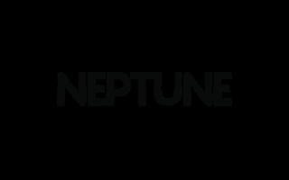

# GFX

```
 ██████╗ ███████╗██╗  ██╗
██╔════╝ ██╔════╝╚██╗██╔╝
██║  ███╗█████╗   ╚███╔╝
██║   ██║██╔══╝   ██╔██╗
╚██████╔╝██║     ██╔╝ ██╗
 ╚═════╝ ╚═╝     ╚═╝  ╚═╝   VGA mode 13h. 320x200. 256 colours.
```

Retro graphics programming for DOS, for the fun of it. Small demos written in C with a
bit of inline assembly, poking the VGA registers and video memory directly, the way it
was done in the early 90s. Everything runs in 16-bit real mode, and you can build it
today on Linux with a single `make`, or in DOS with Turbo C++, like in the old days.

## Demos

### fade: palette tricks



Two images fade in and out without a single pixel being redrawn: only the 256-entry colour
palette changes. Pixels in mode 13h are indices, not colours, so changing the palette
changes everything at once.

* Run it: `make fade`
* Tutorial: [fade/README.md](fade/README.md) (the palette, the DAC, timing)

### stars: animation


A scrolling star field with parallax. Each frame is drawn in an off-screen buffer and
copied to video memory in the vertical retrace, so it is smooth and doesn't flicker.

* Run it: `make stars` (press a key to quit)
* Tutorial: [stars/README.md](stars/README.md) (double buffering, retrace, parallax)

## More demos to come

This is a playground, so more effects will show up over time :-)

## The library

[`vga/`](vga/README.md) is the small VGA library the demos share. Its README has the function
reference and a minimal program.

New to 16-bit C or x86 assembly? The [primer](docs/primer.md) explains the basics you need to read
this code, like segments and far pointers, how to talk to the VGA ports, inline assembly, etc.

## Quick start (Linux)

The demos are cross-compiled to 16-bit DOS with [Open Watcom](https://github.com/open-watcom/open-watcom-v2)
and run in DOSBox. You need `make`, `curl`, `7z` (p7zip-full) and `dosbox`.

    git clone <this repository> && cd GFX
    make toolchain    # Download Open Watcom (~130 MB) and shellcheck into .toolchain/.
    make fade         # Build and run a demo in DOSBox (also: make run-fade).
    make stars
    make              # Build all demos into build/.
    make build/stars.exe   # Build one demo without running it.

The sources are built unmodified: `compat/watcom/alloc.h` maps the few
Borland-specific names they use to their Open Watcom equivalents.

## Building under DOS

The code was written for Turbo C++ 3.0 and Turbo Assembler. Each demo directory has a Makefile
for Borland `MAKE`: run `MAKE` inside `fade` or `stars`, and then run the executable. (The Linux
build is what gets tested; the DOS Makefiles were not re-tested with the latest changes.)

## Repository layout

| Path        | What                                                                 |
|-------------|----------------------------------------------------------------------|
| `vga/`      | The VGA library.                                                     |
| `fade/`     | Fade demo.                                                           |
| `stars/`    | Star field demo.                                                     |
| `docs/`     | The primer, and the GIFs used in this file.                          |
| `util/`     | `bmp2raw.py` (image to raw and palette; needs Pillow and numpy) and `ttf2bmp.sh` (font to image; needs ImageMagick). |
| `compat/`   | The Open Watcom shim for the Borland names.                          |
| `tests/`    | pytest suite for `bmp2raw.py`.                                       |

## Tests, lint and static analysis

    make test         # pytest suite for util/bmp2raw.py (needs pytest, Pillow, numpy).
    make lint         # flake8 (Python), shellcheck (shell) and cppcheck (C).
    make analyze      # Style findings and Open Watcom's maximum warning level.

`make lint` fails only on real problems. `make analyze` is informational: it
reports style issues and the compiler's maximum warnings. `make lint` uses the
shellcheck installed by `make toolchain`, or one in the PATH; without either it
only checks the shell syntax.

## License

GPL v3. See [LICENSE](LICENSE).
